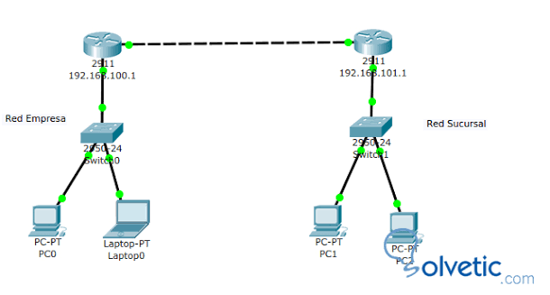

# LABORATORIO: Subnetting IPv4 de Clase A, B y C utilizando Cisco Packet Tracer


## 1. Información general


| Campo | Descripción |

|---|---|

| Curso | Redes y Comunicación de Datos |

| Laboratorio | Subnetting IPv4 con Cisco Packet Tracer |

| Duración | 90 minutos |

| Modalidad | Individual |

| Herramienta | Cisco Packet Tracer |

| Técnica | FLSM (Fixed Length Subnet Mask) |

| Entregables | Archivo `.pkt` e informe `README.md` |


\## 2. Objetivos


Al finalizar el laboratorio, el estudiante será capaz de:


\- Identificar redes IPv4 de clase A, B y C.

\- Calcular subredes utilizando FLSM.

\- Determinar máscaras de subred y prefijos CIDR.

\- Calcular direcciones de red, broadcast y rango de hosts.

\- Diseñar una topología de red en Cisco Packet Tracer.

\- Configurar direcciones IP en PCs y routers.

\- Verificar conectividad utilizando `ping`.

\- Documentar un diseño de red mediante Markdown.


\# PARTE II. EJEMPLO PASO A PASO EN CISCO PACKET TRACER


\## 7. Escenario práctico


Implementaremos una red con dos subredes utilizando:


```text

Red original: 192.168.20.0/24


Subredes requeridas: 2


Prefijo: /25


Máscara: 255.255.255.128

```


\### 7.1 Diseño de la topología


```text

&#x20;                Router R1

&#x20;              G0/0    G0/1

&#x20;               |        |

&#x20;               |        |

&#x20;            Switch1  Switch2

&#x20;               |        |

&#x20;          +----+----+   +----+----+

&#x20;          |         |   |         |

&#x20;         PC1       PC2 PC3       PC4

```


\### 7.2 Direccionamiento IP


| Dispositivo | Interfaz | Dirección IP | Máscara |

|---|---|---|---|

| R1 | G0/0 | 192.168.20.1 | 255.255.255.128 |

| R1 | G0/1 | 192.168.20.129 | 255.255.255.128 |

| PC1 | NIC | 192.168.20.10 | 255.255.255.128 |

| PC2 | NIC | 192.168.20.20 | 255.255.255.128 |

| PC3 | NIC | 192.168.20.130 | 255.255.255.128 |

| PC4 | NIC | 192.168.20.140 | 255.255.255.128 |


Puertas de enlace:


\- PC1 y PC2: `192.168.20.1`

\- PC3 y PC4: `192.168.20.129`


\## 8. Paso 1: Abrir Cisco Packet Tracer


1\. Ejecutar Cisco Packet Tracer.

2\. Crear un proyecto nuevo.

3\. Guardarlo como:


```text

LAB\_SUBNETTING\_CLASE\_C.pkt

```


\## 9. Paso 2: Agregar dispositivos


Desde el panel inferior:


1\. Seleccionar Network Devices.

2\. Seleccionar Routers.

3\. Agregar un router Cisco 2911.

4\. Agregar dos switches Cisco 2960.

5\. Seleccionar End Devices.

6\. Agregar cuatro PCs.


Renombrar los dispositivos:


```text

Router:  R1

Switch:  SW1

Switch:  SW2

PC:      PC1

PC:      PC2

PC:      PC3

PC:      PC4

```


\## 10. Paso 3: Conectar dispositivos


Utilizar conexiones Copper Straight-Through o la opción automática.


| Origen | Destino |

|---|---|

| R1 G0/0 | SW1 G0/1 |

| R1 G0/1 | SW2 G0/1 |

| PC1 FastEthernet0 | SW1 Fa0/1 |

| PC2 FastEthernet0 | SW1 Fa0/2 |

| PC3 FastEthernet0 | SW2 Fa0/1 |

| PC4 FastEthernet0 | SW2 Fa0/2 |


Esperar que los indicadores de enlace cambien a verde.


\## 11. Paso 4: Configurar el router


Seleccionar R1.


Abrir la pestaña CLI.


Ingresar:


```text

enable

configure terminal


hostname R1


interface gigabitEthernet 0/0

ip address 192.168.20.1 255.255.255.128

no shutdown

exit


interface gigabitEthernet 0/1

ip address 192.168.20.129 255.255.255.128

no shutdown

exit


end

write memory

```


\### Verificar configuración


```text

show ip interface brief

```


Resultado esperado:


```text

Interface              IP-Address       Status

GigabitEthernet0/0    192.168.20.1     up

GigabitEthernet0/1    192.168.20.129   up

```


Las interfaces deben estar `up/up`.


\## 12. Paso 5: Configurar PC1


Seleccionar PC1.


Ir a:


```text

Desktop

&#x20;  |

&#x20;  +-- IP Configuration

```


Configurar:


```text

IP Address:      192.168.20.10

Subnet Mask:     255.255.255.128

Default Gateway: 192.168.20.1

```


\## 13. Paso 6: Configurar PC2


```text

IP Address:      192.168.20.20

Subnet Mask:     255.255.255.128

Default Gateway: 192.168.20.1

```


\## 14. Paso 7: Configurar PC3


```text

IP Address:      192.168.20.130

Subnet Mask:     255.255.255.128

Default Gateway: 192.168.20.129

```


\## 15. Paso 8: Configurar PC4


```text

IP Address:      192.168.20.140

Subnet Mask:     255.255.255.128

Default Gateway: 192.168.20.129

```





\## 16. Paso 9: Verificar conectividad


\### Prueba 1: PC1 a PC2


En PC1:


```text

Desktop

&#x20;  |

&#x20;  +-- Command Prompt

```


Ejecutar:


```bash

ping 192.168.20.20

```


Resultado esperado:


```text

Reply from 192.168.20.20

```


\### Prueba 2: PC1 al router


```bash

ping 192.168.20.1

```


\### Prueba 3: PC1 a PC3


```bash

ping 192.168.20.130

```


\### Prueba 4: PC1 a PC4


```bash

ping 192.168.20.140

```


Todos los pings deberán responder correctamente.


Nota: el primer ping puede fallar mientras se resuelve ARP. Repetir la prueba.


\## 17. Paso 10: Verificar tabla de rutas


En R1:


```text

show ip route

```


Se deberán observar dos redes conectadas directamente:


```text

192.168.20.0/25

192.168.20.128/25

```


No se requiere configurar rutas estáticas porque ambas subredes están conectadas directamente al router.


\## 18. Paso 11: Guardar el proyecto


Guardar el archivo:


```text

LAB\_SUBNETTING\_CLASE\_C.pkt

```


Este archivo constituye la evidencia principal del laboratorio.


\---


\# PARTE III. ACTIVIDADES PROPUESTAS


\## 19. Actividad 1: Subnetting Clase A


Red:


```text

10.0.0.0/8

```


Requerimientos:


\- Obtener 16 subredes.

\- Calcular máscara.

\- Calcular prefijo CIDR.

\- Determinar hosts por subred.

\- Calcular dirección de red y broadcast de las primeras 8 subredes.

\- Identificar el rango de hosts de las primeras 4 subredes.


\## 20. Actividad 2: Subnetting Clase B


Red:


```text

172.20.0.0/16

```


Requerimientos:


\- Obtener 32 subredes.

\- Calcular máscara.

\- Calcular prefijo CIDR.

\- Determinar hosts por subred.

\- Calcular dirección de red y broadcast de las primeras 10 subredes.

\- Identificar el rango de hosts de las primeras 5 subredes.


\## 21. Actividad 3: Subnetting Clase C


Red:


```text

192.168.50.0/24

```


Requerimientos:


\- Obtener 8 subredes.

\- Calcular máscara.

\- Calcular prefijo CIDR.

\- Determinar hosts por subred.

\- Calcular dirección de red y broadcast.

\- Identificar el rango de hosts de todas las subredes.


\## 22. Actividad 4: Implementación en Packet Tracer


Utilizando la red:


```text

192.168.50.0/24

```


Implementar:


\- 4 subredes.

\- 1 router.

\- 4 switches.

\- 8 PCs.

\- 2 PCs por subred.


Asignar direcciones IP según los cálculos de subnetting.


Configurar el router para interconectar las cuatro subredes.


Verificar:


\- Comunicación entre PCs de la misma subred.

\- Comunicación entre PCs de diferentes subredes.

\- Comunicación con las interfaces del router.

\- Tabla de rutas del router.


\---


\# PARTE IV. ENTREGABLES


\## 23. Estructura del repositorio GitHub


```text

lab-subnetting/

│

├── README.md

│

├── LAB\_SUBNETTING\_CLASE\_C.pkt

│

└── evidencias/

&#x20;   ├── topologia.png

&#x20;   ├── configuracion\_router.png

&#x20;   ├── configuracion\_pc.png

&#x20;   └── pruebas\_ping.png

```


\## 24. Entregable 1: Archivo Cisco Packet Tracer


El archivo `.pkt` deberá contener:


\- Topología correctamente organizada.

\- Dispositivos correctamente identificados.

\- Direcciones IP configuradas.

\- Máscaras correctas.

\- Puertas de enlace configuradas.

\- Router operativo.

\- Conectividad entre subredes.

\- Archivo guardado con nombre adecuado.


\## 25. Entregable 2: Informe README.md


El informe deberá contener:


\### 25.1 Datos del estudiante


```text

Curso:

Apellidos y nombres:

Grupo:

Fecha:

```


\### 25.2 Desarrollo teórico


\- Concepto de subnetting.

\- Diferencias entre clases A, B y C.

\- Fórmulas utilizadas.

\- Cálculos de subnetting.

\- Tabla de direccionamiento IP.


\### 25.3 Diseño de red


\- Diagrama de topología.

\- Descripción de dispositivos.

\- Descripción de subredes.

\- Tabla de direccionamiento.


\### 25.4 Configuración


\- Configuración del router.

\- Configuración de las PCs.

\- Máscaras y puertas de enlace.

\- Comandos utilizados.


\### 25.5 Pruebas


\- Ping entre PCs de una misma subred.

\- Ping entre PCs de diferentes subredes.

\- Ping hacia el router.

\- Resultado de `show ip route`.

\- Capturas de pantalla.


\### 25.6 Conclusiones


Redactar tres conclusiones relacionadas con:


1\. La importancia del subnetting.

2\. La optimización del direccionamiento IP.

3\. La configuración y verificación de redes en Packet Tracer.


\---


\# PARTE V. EVALUACIÓN


\## 26. Rúbrica de evaluación


| Criterio | Puntaje |

|---|---:|

| Cálculos de subnetting Clase A | 3 |

| Cálculos de subnetting Clase B | 3 |

| Cálculos de subnetting Clase C | 3 |

| Diseño de topología Packet Tracer | 2 |

| Configuración de router y PCs | 3 |

| Pruebas de conectividad | 2 |

| Informe README.md | 3 |

| Organización y presentación | 1 |

| \*\*Total\*\* | \*\*20\*\* |


\## 27. Preguntas de evaluación


1\. ¿Qué diferencia existe entre una dirección IP y una máscara de subred?

2\. ¿Por qué se utilizan bits prestados para crear subredes?

3\. ¿Qué diferencia existe entre una dirección de red y una dirección broadcast?

4\. ¿Cuántos hosts utilizables tiene una subred `/26`?

5\. ¿Qué función cumple la puerta de enlace predeterminada?

6\. ¿Por qué es necesario utilizar un router para comunicar diferentes subredes?

7\. ¿Qué información proporciona el comando `show ip route`?

8\. ¿Qué sucede si una PC tiene una máscara incorrecta?

9\. ¿Por qué dos PCs de diferentes subredes necesitan un router para comunicarse?

10\. ¿Qué ventajas ofrece subnetting en la administración de redes?


\## 28. Reto adicional


Diseñar una red empresarial con:


\- 1 router.

\- 4 switches.

\- 16 PCs.

\- 4 subredes.

\- Direccionamiento IPv4 de clase C.

\- Configuración completa de las interfaces.

\- Pruebas de conectividad.

\- Informe técnico en Markdown.


\## 29. Criterios de presentación


El estudiante deberá:


\- Presentar el archivo `.pkt` funcional.

\- Presentar el informe `README.md`.

\- Utilizar tablas de direccionamiento claras.

\- Mostrar evidencias de las pruebas.

\- Explicar los cálculos realizados.

\- Sustentar la configuración de la red.


\*\*Importante:\*\* No se aceptarán archivos Packet Tracer que solamente contengan dispositivos conectados sin direccionamiento ni pruebas de conectividad.

